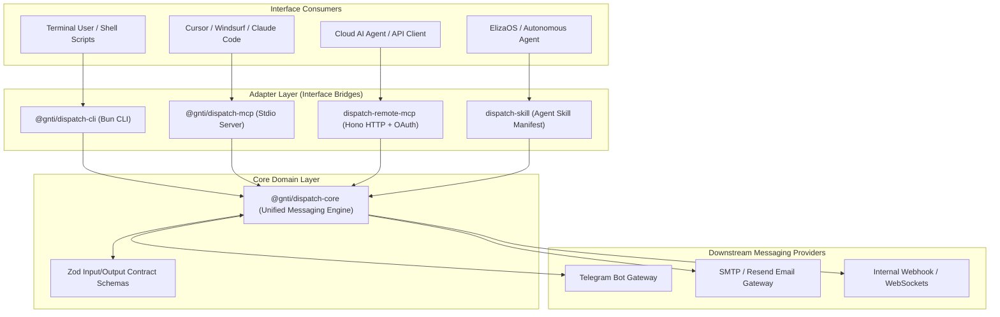

<div align="center">

# GNTI | Dispatch

<p><strong>Agent-Ready Messaging Infrastructure with Unified TypeScript Core for CLI, MCP Servers & Skills</strong></p>

<p>A flagship production foundation engineered by <a href="https://gnti.tech">Galaxy Nova Technologies & Innovations (GNTI)</a>.</p>

<p>
  <a href="https://gnti.tech"></a>&nbsp;
  <a href="https://github.com/GNTI-X/dispatch"></a>&nbsp;
  <a href="./LICENSE"></a>&nbsp;
  <a href="https://gnti.tech/projects/dispatch"></a>
</p>

</div>

---

## 📌 1. System Overview

**Dispatch** is an agent-ready messaging and communication toolkit designed around the "one operation, every interface" architectural philosophy. In modern software and AI ecosystems, communication operations need to be invoked by multiple distinct consumers: humans running terminal commands, local desktop AI assistants (Cursor, Windsurf, Claude Code) communicating over MCP stdio, remote AI agents operating over OAuth-protected HTTP endpoints, and autonomous frameworks (such as ElizaOS) using typed Skill declarations.

Dispatch solves this fragmentation by isolating all core business logic, schema validations, and messaging integrations inside a decoupled TypeScript core package (`@gnti/dispatch-core`). Every other package in the monorepo functions strictly as an adapter, guaranteeing feature parity, zero code duplication, and consistent security across all interfaces.

---

## 🏛 2. Architecture & Monorepo Topology

### Monorepo Structure
```
dispatch/
├── packages/
│   ├── core/         # Unified business logic, schemas, & provider connectors
│   ├── cli/          # Human-facing terminal interface (Bun CLI)
│   ├── local-mcp/    # Stdio Model Context Protocol (MCP) server for local IDEs
│   └── skills/       # Agent skill manifests and tool definitions (ElizaOS)
└── apps/
    └── remote-mcp/   # Remote HTTP MCP server with Clerk OAuth protection
```

### System Architecture Diagram



### End-to-End Workflow

1. **Core Operation Execution**:
   - Every operation (e.g., `sendMessage`, `broadcast`, `fetchHistory`) is defined in `@gnti/dispatch-core` with strict Zod validation schemas.
2. **Local MCP Stdio Transport**:
   - When configured in `claude_desktop_config.json` or Cursor settings, `@gnti/dispatch-mcp` exposes tools via stdio. AI agents can introspect available tools, schema definitions, and execute actions with structured outputs.
3. **Remote HTTP MCP Transport with OAuth**:
   - `dispatch-remote-mcp` spins up a Hono web server implementing the Model Context Protocol over HTTP/SSE.
   - Incoming agent requests authenticate via Clerk Bearer tokens, providing enterprise-grade access control for cloud deployments.
4. **Provider Abstraction**:
   - The core engine abstracts protocol specifics away from adapters. Swapping Telegram for Slack, Discord, or Twilio requires modifying only the provider connector in core—instantly updating all 4 adapters simultaneously.

---

## 🛠 3. Categorized Tech Stack

| Domain | Technology | Purpose |
|:---|:---|:---|
| **Runtime** | `Bun` (>= 1.1) | Execution engine and monorepo workspace package manager |
| **Monorepo Bundler** | `tsdown` (Rollup/esbuild) | Zero-config TypeScript bundling for CLI and library targets |
| **Communication Protocol** | `@modelcontextprotocol/sdk` | Official Anthropic Model Context Protocol specification |
| **HTTP Server** | `Hono` | Edge-compatible micro-framework serving remote MCP endpoints |
| **Authentication** | `Clerk` | OAuth 2.0 / JWT token validation for remote MCP HTTP endpoints |
| **Validation** | `Zod` | Runtime type enforcement and automatic tool schema generation |

---

## 🔑 4. Environment Variables Reference

| Variable | Required | Description |
|:---|:---:|:---|
| `TELEGRAM_BOT_TOKEN` | **Yes** | Telegram bot token obtained from @BotFather |
| `CLERK_SECRET_KEY` | Optional | Required only when deploying `remote-mcp` HTTP server |
| `CLERK_PUBLISHABLE_KEY` | Optional | Required for remote OAuth token introspection |
| `PORT` | Optional | Port for `remote-mcp` (defaults to 3000) |

---

## 🚀 5. Local Development & Setup

```bash
# 1. Clone repository
git clone https://github.com/GNTI-X/dispatch.git
cd dispatch

# 2. Install monorepo dependencies
bun install

# 3. Build all workspace packages
bun run build:core
bun run build:cli
bun run build:local-mcp

# 4. Run CLI interactively
bun run dev:cli --help

# 5. Run Remote MCP Server
cd apps/remote-mcp
bun run dev
```

### Configuring in Cursor or Claude Desktop (Stdio MCP)
Add to your `mcpServers` configuration:
```json
{
  "dispatch": {
    "command": "bun",
    "args": ["run", "/path/to/dispatch/packages/local-mcp/dist/index.js"],
    "env": {
      "TELEGRAM_BOT_TOKEN": "your_token_here"
    }
  }
}
```

---

## 🏢 About GNTI

Galaxy Nova Technologies & Innovations (GNTI) builds and deploys scalable software across multi-tenant SaaS, real-time communication, AI automation, and media streaming infrastructure.

- **Website**: [gnti.tech](https://gnti.tech)
- **Official Specification**: [gnti.tech/projects/dispatch](https://gnti.tech/projects/dispatch)
- **Inquiries**: [contact@gnti.tech](mailto:contact@gnti.tech)

---

## 📄 License

Distributed under the **MIT License**. See [LICENSE](./LICENSE) for details.

Copyright &copy; 2026 [Galaxy Nova Technologies & Innovations (GNTI)](https://gnti.tech). All rights reserved.
